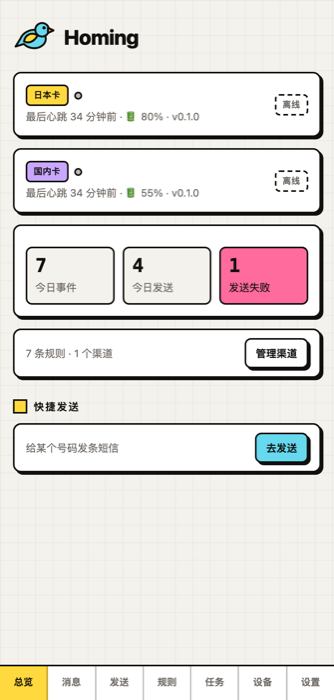
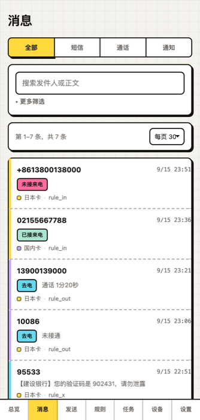
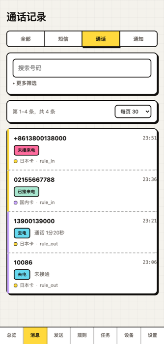
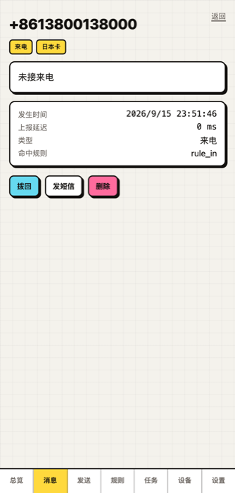
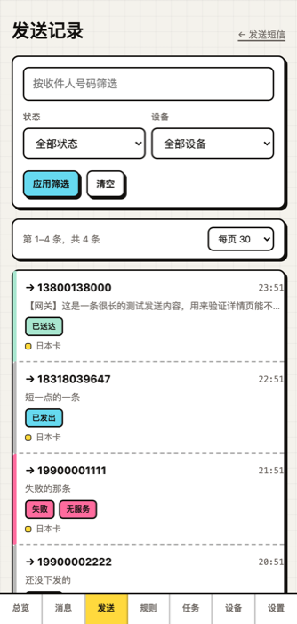
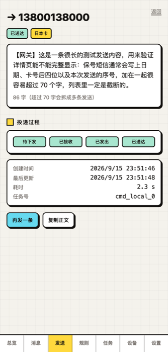
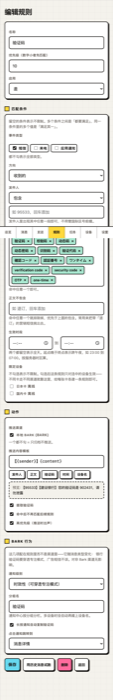
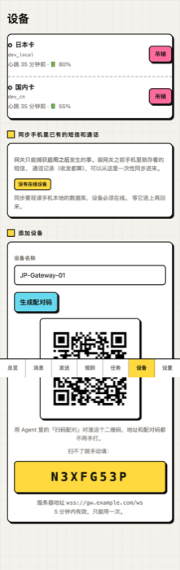
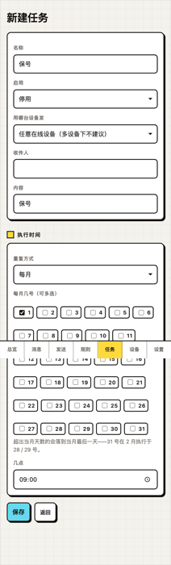
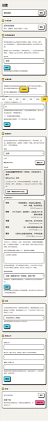

<p align="center">
  
</p>

<h1 align="center">Homing</h1>

<p align="center">
  <b>把一台闲置安卓手机变成你的远程收码机。</b><br>
  手机留在家里守着那张卡，验证码飞到你身边。
</p>

<p align="center">
  <a href="https://github.com/rikouu/homing/releases/latest"></a>
  <a href="LICENSE"></a>
  <a href="https://github.com/rikouu/homing/actions"></a>
</p>

---

名字取自 **homing pigeon（信鸽）**：一只待在老家的鸽子，把消息带到你身边。

人在国外，国内的号码还得用——银行、支付、政务、外卖，验证码一条都躲不掉。
把插着那张卡的旧手机往家里一放，收到的短信、来电、App 通知立刻转发到你的
Telegram / Bark / 自建接口。

<p align="center">
  
  
  
</p>

---

## 目录

- [它能做什么](#它能做什么)
- [和同类工具比，有什么不一样](#和同类工具比有什么不一样)
- [需要准备什么](#需要准备什么)
- [第一步：装服务端（一键）](#第一步装服务端一键)
- [第二步：装手机 App](#第二步装手机-app)
- [第三步：配一个推送渠道](#第三步配一个推送渠道)
- [长什么样](#长什么样)
- [日常怎么用](#日常怎么用)
- [常见问题](#常见问题)
- [安全须知](#安全须知)
- [给开发者](#给开发者)

---

## 它能做什么

| 能力 | 说明 |
| --- | --- |
| **收短信** | 验证码、银行通知、快递短信，到手机的同时推到你眼前 |
| **收来电** | 未接 / 已接，带号码和时间 |
| **收 App 通知** | 很多验证码走 App 推送而不是短信（微信、支付宝、银行 App），一样能抓 |
| **发短信** | 在网页或 Telegram 里让那台手机替你发一条，能看到「已接收 → 已发出 → 已送达」 |
| **通话记录** | 来电、去电、未接，带通话时长，排版和手机上的通话 App 一样 |
| **会话视图** | 按号码归拢成气泡对话，和手机上的短信 App 一个样，可以直接在对话里回复 |
| **历史导入** | 装网关**之前**手机里就存着的短信和通话，可以一次性导进来 |
| **规则分流** | 验证码高优先级穿透专注模式，广告只归档不推送，各类消息走不同渠道 |
| **定时任务** | 定时发短信（保号、提醒），支持每天 / 每周 / 每月 / 每年 / 每隔 N 天 |
| **短信指令** | 人在外面，给那台手机发条短信就能查它的状态（WiFi、电量、网络、位置） |
| **设备定位** | 手机找不到了，让它报一次位置 |
| **电量告警** | 低电量、充电状态变化，主动提醒 |
| **多用户** | 家人各用各的账号，设备、渠道、规则、消息**完全独立**，互相看不见 |
| **多设备** | 几台手机几张卡，每台独立规则与渠道，消息上带设备名 |
| **双卡** | 认得出消息来自 SIM1 还是 SIM2（带号码尾号），发短信和保号都能指定用哪张卡，规则也能按卡分流 |
| **全文检索** | 按关键词、号码、时间、设备、类型翻历史，翻多久以前都行 |

## 和同类工具比，有什么不一样

**手机主动连服务器，不用内网穿透。**
不需要 frp、不需要公网 IP、不需要给手机开端口。手机在任何 NAT 后面都能用，
连上没连上一眼就能看出来。

**验证码在 Telegram 里是模糊的。**
Telegram 的反欺诈系统会封禁转发验证码的机器人——这是踩过的坑，上一版网关真被封过。
所以推给 Telegram 的正文一律打码，点一下才显示。想要「通知栏直接看见验证码、长按即复制」
这种体验，用自建的 Bark（服务端自带，不用另外部署）。

**短信正文是加密存的——但要知道这防的是什么。**
数据库里存的是密文（AES-256-GCM），日志里从不打印正文和验证码。
**加密防的是数据库文件或备份被人拷走，不防运营者**：密钥就在同一台服务器上，
而服务端必须解密正文才能跑规则、提取验证码、转发出去。
所以这个项目做不到端到端加密，也没有「运营者看不到你的短信」这回事。
不放心就自己部署一份——这正是它开源的意义。

两步验证默认开启并强烈建议开着；从 v0.2 起可以自己关掉，但关掉之后
口令要求更长、不能「保持登录 30 天」、也没有自助找回口令的路径。

**一键部署，不用买域名。**
一台刚买的干净 VPS，三行命令装完，自动配好正式 HTTPS 证书（不是自签名，
浏览器不会报红）。有宝塔 / 1Panel 也能装，文档里有专门的章节。

**不做的事**：多卡批量管理、改主叫号码、语音中继、代收验证码 / 接码平台。
这是个人自用工具，请自持 SIM 卡、自持设备，并遵守当地法律。

---

## 需要准备什么

1. **一台闲置安卓手机**（Android 8 以上），插着你要收码的那张卡，能连 WiFi，长期通电
2. **一台 VPS**（阿里云 / 腾讯云 / 甲骨文 / 搬瓦工都行，1 核 1G 足够）
3. 就这些。**不需要买域名**

> 为什么不需要域名？脚本会用 [sslip.io](https://sslip.io) —— 一个公共 DNS 服务，
> 把 `1-2-3-4.sslip.io` 解析到 `1.2.3.4`。它是真实域名，所以能申请到正式的 HTTPS 证书，
> 浏览器不会报「不安全」。

---

## 第一步：装服务端（一键）

SSH 连上你那台**全新的** VPS，粘贴这三行：

```bash
curl -fsSLO https://raw.githubusercontent.com/rikouu/homing/main/scripts/install.sh
less install.sh          # 花一分钟看看它要干什么，养成好习惯
sudo bash install.sh
```

脚本会自动完成：装 Docker → 拉代码 → 生成密钥 → 申请 HTTPS 证书 → 启动。
第一次要几分钟（主要花在编译上）。跑完它会打印你的控制台地址：

```
  控制台地址   https://1-2-3-4.sslip.io
  Agent 地址   wss://1-2-3-4.sslip.io/ws
```

**装之前先做一件事**：到云服务商控制台的【安全组 / 防火墙】里放行 **80** 和 **443** 端口。
不放行就申请不到证书。

- 阿里云：ECS → 实例 → 安全组 → 配置规则 → 入方向 → 手动添加 → 端口 80、443，授权对象 `0.0.0.0/0`
- 腾讯云：云服务器 → 安全组 → 添加规则，同上

想先看看脚本会做什么而不真的执行：`bash install.sh --dry-run`

### 这台机器上已经有网站怎么办

脚本会检测到 80/443 被占用并拒绝执行——这是故意的，免得把你现有的网站搞挂。
这种情况请看 [手动部署教程](docs/DEPLOY.md)，里面有宝塔 / 1Panel / 已有 Nginx 三种情况的配置方法。

### 打开控制台

浏览器访问打印出来的地址，跟着向导走：

1. **设置用户名与口令**（至少 8 位，字母 / 数字 / 符号里占两类）
2. **绑定两步验证**：用手机上的 Google Authenticator、1Password、Authy 之类扫码，
   然后输入 6 位数字确认。

   可以跳过，但要知道代价：这个网页上能看到你所有的验证码，而跳过之后口令就是
   唯一的钥匙。所以跳过要求口令至少 **12 位且同时含字母、数字、符号**，
   而且不能用「保持登录 30 天」，也**没有自助找回口令的路径**。
3. 完成

> 绑了两步验证，忘了口令可以用动态码自助重置。
> **没绑的话没有找回流程**——请当场把口令存进密码管理器。

---

## 第二步：装手机 App

1. 到 [Releases](https://github.com/rikouu/homing/releases) 下载最新的 `homing-agent.apk`
2. 传到那台安卓手机上安装（会提示「未知来源」，允许即可）
3. 打开 App，点 **申请权限**，把短信、通话、电话状态几项都允许
4. 回到电脑上的控制台 → **设备** 页 → 填个名字（比如「家里的手机」）→ **生成配对码**
5. 手机 App 上点 **扫码配对**，对着屏幕上的二维码扫一下

扫完就连上了。App 首页会显示「● 已连接」。

### 让它一直活着（重要）

安卓系统会杀后台应用。App 里有两个按钮，**都点一遍**：

- **加入电池优化白名单** —— 必点
- **授予通知使用权** —— 想抓 App 推送的验证码就点

另外在系统设置里：

- 找到这个 App → 电池 → 选「无限制」/「不受限制」
- 小米：安全中心 → 应用管理 → 自启动 → 打开
- 华为：手机管家 → 应用启动管理 → 关闭自动管理 → 三个开关全开
- OPPO / vivo：设置 → 电池 → 后台高耗电 → 允许

最后把手机**插上充电器**，别让它关机。

---

## 第三步：配一个推送渠道

控制台 → **设置** → **通知渠道** → **管理**。

### 方案 A：Telegram（最省事）

1. 在 Telegram 里找 [@BotFather](https://t.me/BotFather)，发 `/newbot`，按提示起个名字
2. 它会给你一串 **Bot Token**，形如 `123456789:AAH...`
3. 给你新建的机器人发一句 `/start`（**这一步不能少**，否则它不能主动给你发消息）
4. 控制台里选 Telegram，粘贴 Token，点「自动获取 Chat ID」
5. 点「测试」，手机上应该立刻收到一条

> Telegram 里的验证码会显示成一块灰条，点一下才看得见。这是故意的，
> 明文转发验证码会导致机器人被封。

### 方案 B：Bark（iPhone 用户推荐）

验证码直接出现在通知栏，长按就复制，不用打开任何 App。

1. iPhone 上装 [Bark](https://apps.apple.com/app/bark-customed-notifications/id1403753865)
2. 控制台 → 渠道 → 选 Bark，把第一步那个**二维码**用 Bark App 的「服务器」页扫一下
3. Bark 首页会出现一串设备 Key —— 把 App 里任意一条示例地址整条复制，
   粘到控制台的「或粘贴整条推送地址」框里，Key 会自动填好
4. 点「测试」

### 然后写入推荐规则

渠道配好后，控制台 → **规则** → **写入建议规则**。一共七条，开箱即用：

| 规则 | 作用 |
| --- | --- |
| 验证码 | 高优先级，穿透专注模式，自动提取验证码 |
| 广告推广 | 只归档，不打扰你 |
| 应用通知 | App 推来的验证码走这条 |
| 已发送短信 | 你自己发的，只留记录 |
| 普通短信 | 以上都不是，正常推送 |
| 来电 | 单独分组 |
| 去电 | 只留记录 |

---

## 长什么样

<table>
<tr>
  <td width="33%"><br><sub><b>消息</b><br>短信 / 通话 / 通知分开看，左侧色带一眼区分类型</sub></td>
  <td width="33%"><br><sub><b>消息详情</b><br>完整正文、上报延迟、命中了哪条规则</sub></td>
  <td width="33%"><br><sub><b>通话记录</b><br>来电 / 去电 / 未接，带通话时长</sub></td>
</tr>
<tr>
  <td><br><sub><b>发送记录</b><br>网关替你发出去的每一条，按状态筛</sub></td>
  <td><br><sub><b>发送详情</b><br>投递过程一步步可见，失败原因直给</sub></td>
  <td><br><sub><b>规则编辑</b><br>不用写正则，关键词点一下就是一个标签</sub></td>
</tr>
<tr>
  <td><br><sub><b>扫码配对</b><br>手机扫一下，地址和配对码都不用手打</sub></td>
  <td><br><sub><b>计划任务</b><br>每天 / 每周 / 每月 / 每年 / 每隔 N 天</sub></td>
  <td><br><sub><b>短信指令</b><br>人不在手机旁，发条短信查它的状态</sub></td>
</tr>
</table>

---

## 日常怎么用

### 查历史

**消息**页顶部有四个标签：全部 / 短信 / 通话 / 通知。
搜索框搜关键词，「更多筛选」里能按号码、设备、时间范围筛，每页可选 30 / 50 / 100 条。

号码和正文是加密存的，搜关键词要逐条解开比对，所以一次搜索有时间预算。
搜不完时会明确告诉你「搜到 X 月 X 日为止」，给你「继续往更早搜」的按钮。
**要翻很久以前的，先框个时间范围再搜，快得多。**

### 同步手机里已有的记录

网关只能捕获**启用之后**发生的事。装它之前手机里存着的短信和通话，
到**设备**页 → **同步手机里已有的短信和通话**，选时间范围。两个按钮：

- **同步（只增不删）**：手机上有、网关没有的补进来。安全，随便点。
- **与手机对齐**：双向。手机上有网关没有的补进来，**手机上已经删掉的，网关里也删掉**。

同步进来的记录**只进历史、不会推送**——否则几千条旧短信会一次性砸到你手机上。
重复点不会产生重复记录。

> 「对齐」会删数据，所以它先给你一份计划：要删几条、长什么样、比对的是哪段时间，
> 确认之后才动手。**比手机最老那条记录还早的一概不碰**——手机的短信库通常只留几个月，
> 而网关是长期归档，超出手机覆盖范围的部分无从判断是「你删了」还是「手机从来没存过」。

### 发短信

**发送**页选设备、填号码和内容。发出后能看到状态一路走：
已接收 → 已发出 → 已送达。点右上角「发送记录」看全部历史，点任意一条看完整正文。

> 停在「已发出」不一定是失败。很多运营商不回送达报告，那样它就停在这一步。

### 人不在手机旁边时

**设置** → **短信指令**，打开后系统会给你一个口令。之后用**任何一台手机**
给那台设备的号码发条短信就能查状态：

```
口令 状态      →  连没连上、WiFi、电量、有没有积压
口令 网络      →  WiFi 开没开、连的哪个
口令 电量      →  剩多少电、在不在充电
口令 定位      →  回一条带地图链接的位置
口令 重连      →  立刻重连服务端
```

口令和指令中间的空格**可有可无**，全角半角都认，不打空格也行。
故意**不支持发短信指令**——万一口令被人看到，他最多只能问出手机还活着。

### Telegram 里也能查

给机器人发 `/help` 看全部命令。常用的：

```
/status          设备状态、电量、今日统计
/recent 20       最近 20 条消息
/search 验证码    全文检索
/from 95533      按号码查
/calls           最近来电
/sent            网关发出的短信
/send 号码 内容   发短信
```

### 定时发短信（保号）

**任务**页 → 新建。支持每天 / 每周 / 每月 / 每年 / 每隔 N 天，
可以指定第一次执行的具体时间。建好后有「立即测试」按钮，先确认能通再等它自己跑。

---

## 常见问题

**Q：手机过一阵就掉线了？**
A：九成是被系统杀了后台。把[第二步](#让它一直活着重要)里的保活设置全做一遍，
尤其是电池优化白名单和厂商的自启动管理。再不行就把 App 加到「锁定/加锁」的任务列表里。

**Q：收不到 Telegram 推送？**
A：按顺序查：① 是否给机器人发过 `/start`；② 控制台渠道页点「测试」有没有反应；
③ 规则页看看是不是命中了「只归档」的规则。

**Q：验证码在 Telegram 里看不见？**
A：那是打码效果，点一下灰条就显示。想直接看见请用 Bark。

**Q：证书申请失败 / 网页打不开？**
A：安全组放行 80、443 了吗？放行后等一两分钟会自动重试。
查日志：`docker compose -f docker-compose.deploy.yml logs caddy`

**Q：忘记管理员口令了？**
A：没有找回流程。SSH 到服务器，`docker compose exec gateway node -e` 清掉 `settings` 表里的
`admin_password_hash` 和 `initialized`，然后重新走一遍向导（历史数据不受影响）。

**Q：能收微信验证码吗？**
A：能。微信的验证码走 App 推送，需要在 App 里「授予通知使用权」，
再到控制台 → 设置 → 应用通知捕获里打开。

**Q：换手机 / 重装 App 怎么办？**
A：控制台生成新配对码扫一次就行。老设备记录可以在设备页吊销。

**Q：会不会很费电？**
A：一条 WebSocket 长连接 + 30 秒心跳，实测一天几个百分点。插着电用就没感觉。

---

## 安全须知

这个网页上能看到你所有的短信，包括银行验证码。请当真对待以下几条：

1. **`.env` 里的 `GW_DEK` 是数据密钥，必须备份，而且不要和 `data/` 放在一起。**
   它丢了，所有历史消息都解不开，没有找回办法。
2. **两步验证能关，但别关**。关掉之后口令是唯一的钥匙，而登录失败锁定是按 IP 的，
   换个代理池就清零。真要关，口令至少 12 位三类（系统会强制这一点）。
3. 控制台口令用密码管理器生成，别和别的地方重复。
4. 陌生网段登录会主动告警到你的渠道。口令被重置（自助找回或管理员重置）也会推一条通知。
5. 服务器上除了 80/443 不要开别的端口给公网。

---

## 给开发者

架构、协议、开发环境、测试方式见 [docs/DEVELOPING.md](docs/DEVELOPING.md)。

一句话版本：服务端 TypeScript（Node 24，`node:sqlite`，零运行时依赖注入的 `store`/`hub` 接口，
为将来迁 Cloudflare Workers 预留），Agent 是 Kotlin 原生，控制台是零构建的 vanilla JS。
测试 430+ 个，`pnpm exec vitest run`。

## 作者

Kou. — [kou.im](https://kou.im)

## 许可证

[AGPL-3.0](LICENSE)。

Agent 部分裁剪自 [SmsForwarder](https://github.com/pppscn/SmsForwarder)（BSD 2-Clause），
沿用其逻辑的文件在头部注明了来源，版权声明保留在 [NOTICE](NOTICE)。
